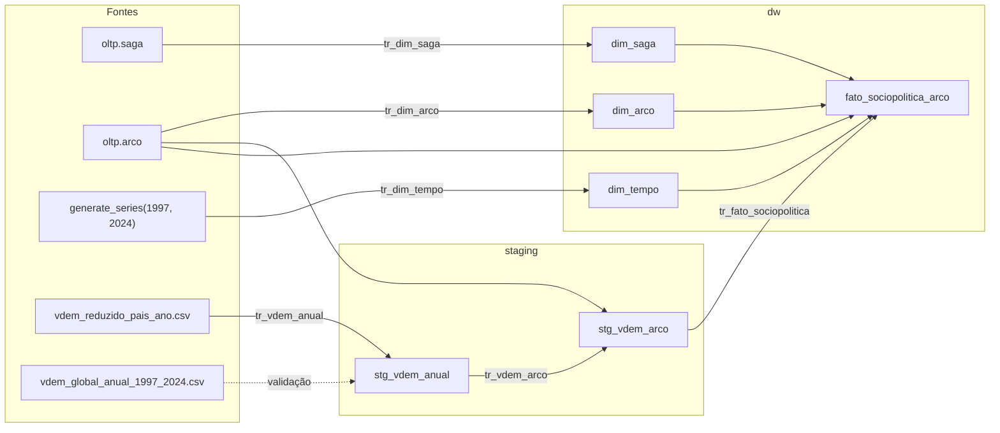
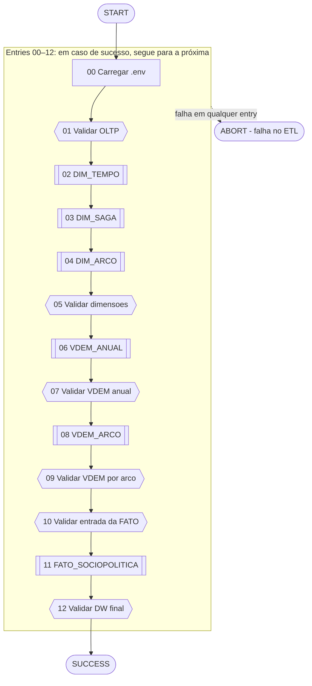

# 2. Documentação do processo ETL

## 2.1 Visão geral

O ETL integra duas fontes num esquema estrela com grão de **um arco**:

- **One Piece:** tabelas `oltp.saga` (11 linhas) e `oltp.arco` (32 linhas, 1.125 capítulos), com classificações temáticas `op_final`, `des_final`, `dis_final`, `res_final` e `isa_final`.
- **V-Dem:** arquivo `data/vdem_reduzido_pais_ano.csv` (4.985 observações país-ano, 1997–2024), já filtrado na primeira entrega. O arquivo `data/vdem_global_anual_1997_2024.csv` serve apenas como referência de validação.

O fluxo de dados passa por três camadas no mesmo banco:

Linhas tracejadas indicam uso apenas para validação; o CSV global não alimenta nenhuma tabela.

Todas as transformações usam uma única conexão, `POSTGRES_TABD` (PostgreSQL, acesso nativo), parametrizada pelas variáveis `POSTGRES_HOST`, `POSTGRES_PORT`, `POSTGRES_DB`, `POSTGRES_USER` e `POSTGRES_PASSWORD`. O Job lê essas variáveis do `.env` da raiz do projeto. Os CSVs são localizados por caminho relativo ao arquivo da transformação (`${Internal.Transformation.Filename.Directory}/../../data/`).

## 2.2 `tr_dim_tempo.ktr` — Dimensão tempo

| Item | Descrição |
|---|---|
| Objetivo | Uma linha por ano do recorte, com a década correspondente |
| Origem | Série gerada no PostgreSQL: `generate_series(1997, 2024)` |
| Destino | `dw.dim_tempo (sk_tempo, ano, decada)` |
| Chave natural | `ano` (`UNIQUE`) |
| Chave substituta | `sk_tempo`, `IDENTITY` gerada pelo PostgreSQL |

| Step | Tipo | Função |
|---|---|---|
| `Ler dados de origem` | Table Input | `SELECT ano, (ano/10)*10 AS decada FROM generate_series(1997,2024)` |
| `Inserir ou atualizar dimensao` | Insert/Update | Busca por `ano`; insere se ausente; atualiza `decada` se mudou |

**Regra de transformação:** `decada = (ano / 10) * 10`, em divisão inteira. O banco reforça a regra com `CHECK (decada = (ano / 10) * 10)`.

**Resultado esperado:** 28 linhas.

## 2.3 `tr_dim_saga.ktr` e `tr_dim_arco.ktr` — Dimensões descritivas

As duas transformações têm a mesma estrutura de dois steps.

| Item | `tr_dim_saga` | `tr_dim_arco` |
|---|---|---|
| Origem | `oltp.saga` | `oltp.arco` |
| Consulta | `id_saga AS id_saga_origem, nome_saga` | `id_arco AS id_arco_origem, nome_arco` |
| Destino | `dw.dim_saga` | `dw.dim_arco` |
| Chave natural (lookup) | `id_saga_origem` (`UNIQUE`) | `id_arco_origem` (`UNIQUE`) |
| Atributo atualizável | `nome_saga` | `nome_arco` |
| Chave substituta | `sk_saga` (`IDENTITY`) | `sk_arco` (`IDENTITY`) |
| Linhas esperadas | 11 | 32 |

**Tratamento de mudanças:** o Insert/Update sobrescreve o nome quando ele muda na origem (SCD tipo 1). A chave substituta é preservada, porque a chave natural nunca é atualizada (`update = N`).

## 2.4 `tr_vdem_anual.ktr` — Médias mundiais anuais

| Item | Descrição |
|---|---|
| Objetivo | Agregar as 4.985 observações país-ano em 28 médias mundiais anuais e convertê-las para a escala do projeto |
| Origem | `data/vdem_reduzido_pais_ano.csv` (CSV com cabeçalho, separador vírgula, UTF-8) |
| Referência | `data/vdem_global_anual_1997_2024.csv` |
| Destino | `staging.stg_vdem_anual` (13 colunas, `NUMERIC(7,5)` e contagens `INTEGER`) |
| Chave | `year` (`PRIMARY KEY`) |

| Step | Tipo | Função |
|---|---|---|
| `01 Ler CSV pais-ano` | CSV File Input | Lê `country_id`, `country_text_id`, `country_name`, `year` e os quatro indicadores |
| `02 Ordenar pelo ano` | Sort Rows | Ordena por `year`, como exige o Group By |
| `03 Calcular medias mundiais` | Group By | Para cada indicador, calcula a média (`AVERAGE`) e o número de valores não nulos (`COUNT_ALL` → `qtd_paises_*`) |
| `04 Adicionar constantes` | Add Constants | `um = 1` e `casas_decimais = 5` |
| `05 Arredondar e inverter` | Calculator | Arredonda as 4 médias a 5 casas (`ROUND_STD_2`); calcula `op_real`, `des_real`, `dis_real` como `1 − média`; copia `part_civil_real = v2x_cspart` |
| `06 Ler CSV de referencia` | CSV File Input | Lê as 28 linhas do CSV global anual |
| `07 Comparar com referencia` | Stream Lookup | Busca pelo `year` os 12 valores de referência (`ref_*`) |
| `08 Calcular divergencias` | Calculator | `diff_* = |calculado − referência|` para os 8 indicadores e as 4 contagens |
| `09 Diverge da referencia?` | Filter Rows | Verdadeiro se o ano não existe na referência ou se algum `diff_*` > 0,000001 |
| `10 Abortar se divergente` | Abort | Interrompe com erro na primeira linha divergente |
| `11 Inserir ou atualizar` | Insert/Update | Upsert em `staging.stg_vdem_anual` pela chave `year`; atualiza as outras 12 colunas |

**Regras de transformação:**

1. As médias são aritméticas, sobre os países com valor no ano. Cada país tem o mesmo peso.
2. Inversão dos indicadores de liberdade e igualdade em medidas de opressão, desigualdade e discriminação: `op_real = 1 − v2x_clpol`, `des_real = 1 − v2xeg_eqdr`, `dis_real = 1 − v2xeg_eqprotec`.
3. A participação civil é mantida na escala original: `part_civil_real = v2x_cspart`.
4. A precisão é de 5 casas decimais, igual à do CSV de referência.

**Validação interna:** os steps 06–10 comparam cada ano com o CSV global. O CSV não alimenta a carga. Por cálculo independente [C], as 28 médias arredondadas e as 112 contagens de países coincidem exatamente com a referência. A comparação aprovada nas execuções no PDI é relatada pela equipe [U].

**Resultado esperado:** 28 linhas.

**Pendência conhecida:** 26 atualizações redundantes por reexecução. A causa está em 01_auditoria_tecnica.md, achado A4.

## 2.5 `tr_vdem_arco.ktr` — Integração temporal arco × V-Dem

| Item | Descrição |
|---|---|
| Objetivo | Atribuir a cada arco a média dos indicadores anuais ao longo do seu período de publicação |
| Origens | `oltp.arco` e `staging.stg_vdem_anual` |
| Destino | `staging.stg_vdem_arco (id_arco_origem, op_real, des_real, dis_real, part_civil_real)`, `NUMERIC(7,6)` |
| Chave | `id_arco_origem` (`PRIMARY KEY`, FK para `oltp.arco`) |

| Step | Tipo | Função |
|---|---|---|
| `01 Relacionar arcos e anos` | Table Input | `oltp.arco JOIN stg_vdem_anual ON year BETWEEN ano_inicio AND ano_fim`; uma linha por combinação arco-ano (58) |
| `02 Ordenar por arco` | Sort Rows | Ordena por `id_arco_origem` |
| `03 Medias do periodo` | Group By | Média de cada indicador real por arco (e `anos_encontrados`, que não é gravado) |
| `04 Adicionar precisao` | Add Constants | `casas_decimais = 6` |
| `05 Arredondar indicadores` | Calculator | Arredonda as 4 médias a 6 casas (`ROUND_STD_2`) |
| `06 Inserir ou atualizar` | Insert/Update | Upsert por `id_arco_origem` |

**Regra de integração temporal:** o intervalo de publicação é inclusivo nas duas pontas. Um arco publicado de 2010 a 2012 recebe a média simples de 2010, 2011 e 2012, cada ano com o mesmo peso, sem ponderação por capítulos. Os arcos concentrados num único ano recebem o valor daquele ano. Os 32 arcos produzem 58 combinações arco-ano [C].

**Resultado esperado:** 32 linhas.

## 2.6 `tr_fato_sociopolitica.ktr` — Tabela fato

| Item | Descrição |
|---|---|
| Objetivo | Carregar a fato com as medidas temáticas de One Piece e os indicadores V-Dem do período de cada arco |
| Origens | `oltp.arco`, `dw.dim_arco`, `dw.dim_saga`, `dw.dim_tempo` (duas vezes), `staging.stg_vdem_arco` |
| Destino | `dw.fato_sociopolitica_arco` |
| Chave de lookup | `sk_arco` (`UNIQUE`); `sk_fato` é gerada pelo PostgreSQL |

| Step | Tipo | Função |
|---|---|---|
| `01 Integrar fontes e dimensoes` | Table Input | Junções internas que resolvem as chaves substitutas pelas chaves naturais e anexam os indicadores V-Dem |
| `02 Inserir ou atualizar fato` | Insert/Update | Busca por `sk_arco`; insere se ausente; atualiza as outras 15 colunas se mudaram |

**Resolução de chaves:**

| Coluna da fato | Origem |
|---|---|
| `sk_arco` | `dim_arco.id_arco_origem = arco.id_arco` |
| `sk_saga` | `dim_saga.id_saga_origem = arco.id_saga` |
| `sk_tempo_inicio` | `dim_tempo.ano = arco.ano_inicio` |
| `sk_tempo_fim` | `dim_tempo.ano = arco.ano_fim` |

**Medidas:**

- Copiadas do OLTP: `qtd_capitulos`, `op_final`, `des_final`, `dis_final`, `res_final`, `isa_final`.
- Derivada: `duracao_publicacao_anos = ano_fim − ano_inicio + 1`.
- Copiadas de `stg_vdem_arco`: `op_real`, `des_real`, `dis_real`, `part_civil_real`.
- Constante: `qtd_arcos = 1` (medida aditiva para contagem).

**Restrições no banco:** FKs para as três dimensões; `CHECK (isa_final = op_final + des_final + dis_final + res_final)`; `CHECK (qtd_arcos = 1)`; faixas de valores para todas as medidas.

**Resultado esperado:** 32 linhas, com soma de 1.125 capítulos.

## 2.7 `job_etl_principal.kjb` — Orquestração

### Sequência

| # | Entry | Tipo | Pré-condição verificada / efeito |
|---|---|---|---|
| — | `START` | Início | Execução manual, sem agendamento |
| 00 | `Carregar .env` | Set Variables | Lê o `.env` com escopo JVM; falha se o arquivo não existir |
| 01 | `Validar OLTP` | SQL | 11 sagas, 32 arcos, 1.125 capítulos; `ano_inicio ≤ ano_fim`; ISA = soma dos quatro temas |
| 02 | `DIM_TEMPO` | Transformação | `tr_dim_tempo.ktr` |
| 03 | `DIM_SAGA` | Transformação | `tr_dim_saga.ktr` |
| 04 | `DIM_ARCO` | Transformação | `tr_dim_arco.ktr` |
| 05 | `Validar dimensoes` | SQL | 28/11/32 linhas; todos os anos 1997–2024 com década correta; nomes iguais aos do OLTP |
| 06 | `VDEM_ANUAL` | Transformação | `tr_vdem_anual.ktr` (inclui a comparação com o CSV global) |
| 07 | `Validar VDEM anual` | SQL | 28 linhas sem lacunas; nenhum indicador nulo; inversões corretas (`op_real = 1 − v2x_clpol` etc.); contagens > 0 |
| 08 | `VDEM_ARCO` | Transformação | `tr_vdem_arco.ktr` |
| 09 | `Validar VDEM por arco` | SQL | 32/28/32 linhas; nenhum ano de publicação sem indicador; exatamente 58 combinações; todo arco com linha na staging; médias recalculadas no PostgreSQL (`ROUND(AVG(...), 6)`) iguais às gravadas |
| 10 | `Validar entrada da FATO` | SQL | Fontes completas (32/11/28/32/32); todas as chaves resolvíveis por `LEFT JOIN`, sem nulos; nomes das dimensões iguais aos do OLTP |
| 11 | `FATO_SOCIOPOLITICA` | Transformação | `tr_fato_sociopolitica.ktr` |
| 12 | `Validar DW final` | SQL | 32 linhas; comparação coluna a coluna (16 campos) entre a fato e a consulta de integração, via `FULL JOIN`; nenhum `sk_arco` duplicado; nenhum indicador nulo; ISA consistente; soma de capítulos = 1.125 |
| — | `SUCCESS` | Fim | Execução concluída |
| — | `ABORT - falha no ETL` | Abort | Encerra o Job com status de falha |

### Hops e tratamento de erro

- `START → 00` é incondicional.
- Cada entry de 00 a 12 tem dois hops de saída: em caso de sucesso, segue para a próxima entry; em caso de falha, vai para `ABORT - falha no ETL`. A execução é estritamente sequencial (nenhuma entry com `parallel = Y`).
- Uma validação SQL falha por `RAISE EXCEPTION` com mensagem descritiva, e a falha se propaga pelo hop de erro. Uma transformação falha por erro de step, incluindo o step `Abort` de `tr_vdem_anual`.
- As transformações são executadas com `wait_until_finished = Y` e log `Basic`.

### Dependências

Legenda: retângulo com bordas duplas = execução de transformação; hexágono = validação SQL; retângulo simples = definição de variáveis. No arquivo `.kjb`, cada entry tem seu próprio hop de falha para o ABORT; o diagrama agrupa esses 13 hops numa única seta tracejada.

A ordem é necessária: a fato (11) depende das três dimensões e da staging por arco; a staging por arco (08) depende da staging anual (06) e do OLTP.

## 2.8 Idempotência

| Destino | Chave de lookup | Garantia no banco | Comportamento na reexecução |
|---|---|---|---|
| `dw.dim_tempo` | `ano` | `UNIQUE` | Nenhuma inserção; nenhuma atualização |
| `dw.dim_saga` | `id_saga_origem` | `UNIQUE` | Idem |
| `dw.dim_arco` | `id_arco_origem` | `UNIQUE` | Idem |
| `staging.stg_vdem_anual` | `year` | `PRIMARY KEY` | Nenhuma inserção; 26 atualizações redundantes [U] (achado A4) |
| `staging.stg_vdem_arco` | `id_arco_origem` | `PRIMARY KEY` | Nenhuma inserção |
| `dw.fato_sociopolitica_arco` | `sk_arco` | `UNIQUE` | Nenhuma inserção |

As chaves substitutas (`sk_*`) só são geradas na primeira inserção e nunca são atualizadas, então a fato mantém as mesmas referências entre execuções. O Job não apaga nem trunca nenhuma tabela.

**Resultados relatados [U]:** três execuções consecutivas do Job concluídas com sucesso, sem duplicidades, com os registros preservados e com as comparações com a referência aprovadas.

## 2.9 Logs

- Cada transformação registra, no nível Basic, uma linha por step com os contadores `I` (lidas de entrada), `O` (gravadas), `R` (lidas de steps anteriores), `W` (escritas para steps seguintes), `U` (atualizadas) e `E` (erros). No Insert/Update, `O` indica inserções e `U` indica atualizações.
- As validações SQL emitem `RAISE NOTICE 'OK ...'` em caso de sucesso e `RAISE EXCEPTION` com os valores encontrados e esperados em caso de falha. A exibição dos NOTICEs no log do Spoon não foi verificada (achado A6).
- O step `10 Abortar se divergente` registra as linhas divergentes (`always_log_rows = Y`).
- Não há tabelas de log configuradas (achado A11).
